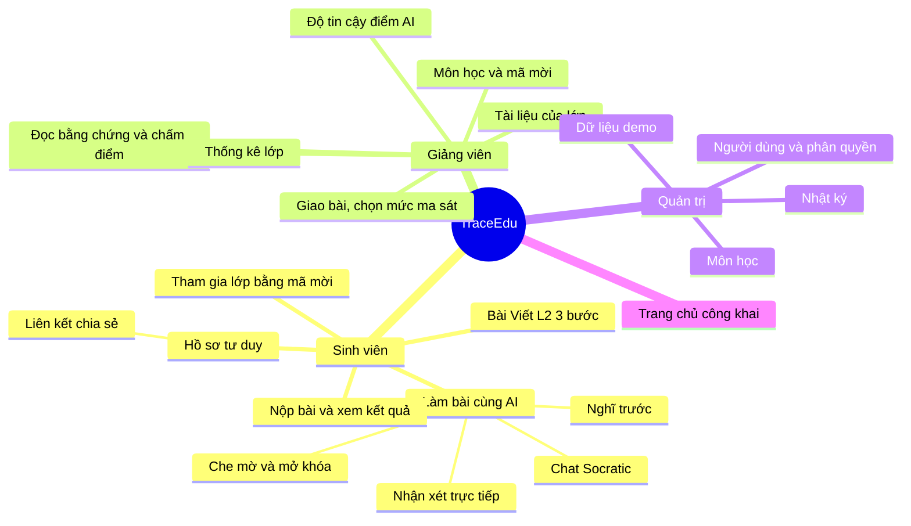
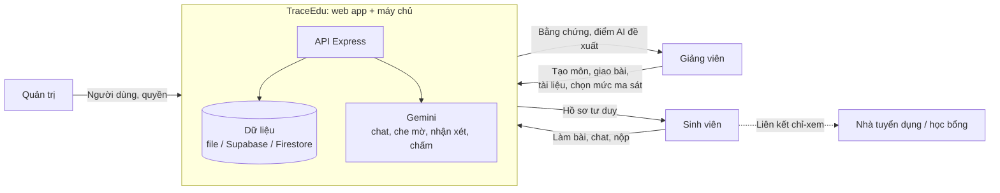
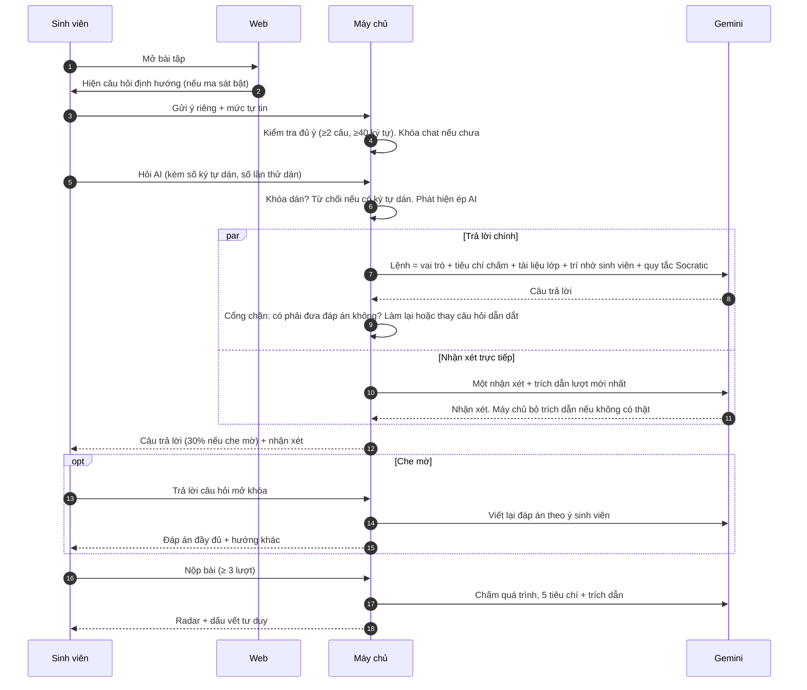
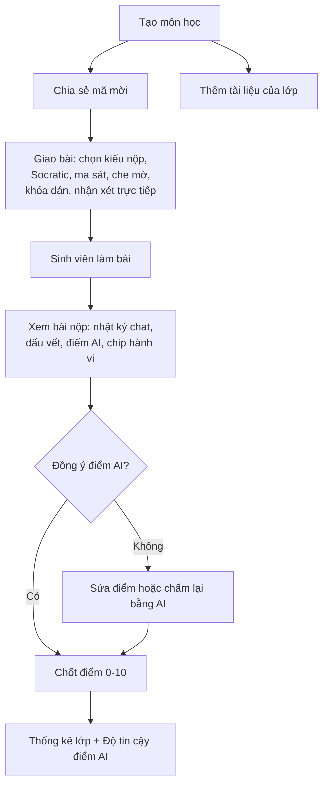
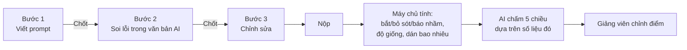
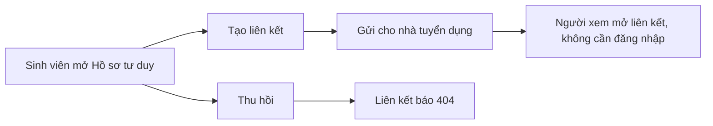

# TraceEdu: Tài liệu sản phẩm đầy đủ

> **Less Paste, More Trace.**
> Nền tảng giáo dục nơi AI biết lùi lại đúng lúc, để tư duy độc lập được phép bắt đầu.

| | |
|---|---|
| Phiên bản tài liệu | 1.0, ngày 20/11/2026 |
| Trạng thái sản phẩm | MVP chạy được (web app), đã thử với dữ liệu demo |
| Mã nguồn | Repo `lauyennhi/trace-ai`, nhánh `claude/friendly-planck-3carcb` |
| Tài liệu này gồm | Định vị, chức năng, flow, giao diện, kiến trúc, nghiên cứu thị trường, rủi ro, lộ trình |

**Cách đọc nhãn trạng thái trong tài liệu**

| Nhãn | Nghĩa |
|---|---|
| ✅ Đã có | Có trong code, đã được kiểm tra tự động hoặc duyệt thử trên trình duyệt |
| 🟡 Một phần | Có nhưng còn giới hạn, nêu rõ trong mục tương ứng |
| ⛔ Chưa có | Chưa có trong code. Một số mục đang được nhắc trên trang chủ, xem mục 3.9 |
| 🔬 Chưa kiểm chứng | Có tính năng nhưng chưa có số liệu thực nghiệm về hiệu quả |

---

## Mục lục

1. [Tóm tắt điều hành](#1-tóm-tắt-điều-hành)
2. [Vấn đề và định vị](#2-vấn-đề-và-định-vị)
3. [Chức năng](#3-chức-năng)
4. [Flow hoạt động](#4-flow-hoạt-động)
5. [Giao diện và nhận diện thương hiệu](#5-giao-diện-và-nhận-diện-thương-hiệu)
6. [Kiến trúc kỹ thuật](#6-kiến-trúc-kỹ-thuật)
7. [Phân tích thị trường](#7-phân-tích-thị-trường)
8. [Mô hình kinh doanh và đi ra thị trường (giả thuyết)](#8-mô-hình-kinh-doanh-và-đi-ra-thị-trường-giả-thuyết)
9. [Rủi ro và giới hạn trung thực](#9-rủi-ro-và-giới-hạn-trung-thực)
10. [Lộ trình](#10-lộ-trình)
11. [Phụ lục](#11-phụ-lục)

---

## 1. Tóm tắt điều hành

**TraceEdu là gì.** Một lớp học trực tuyến (giống Google Classroom về hình thức) trong đó sinh viên làm bài **cùng một trợ lý AI**, nhưng AI được thiết kế để **không làm hộ**. Toàn bộ quá trình sinh viên nghĩ, hỏi, phản biện và viết lại được ghi thành **"dấu vết tư duy"**. AI chấm quá trình này theo 5 tiêu chí kèm bằng chứng, và **giảng viên là người chốt điểm cuối**.

**Vấn đề giải quyết.** Gần như mọi sinh viên đã dùng AI cho bài tập. Giảng viên không còn biết bài nộp là sức nghĩ của sinh viên hay của máy, và các công cụ "bắt AI" (AI detector) bị nhiều trường bỏ vì sai số và bất công với người viết không phải bản ngữ. TraceEdu đổi câu hỏi từ *"bài này có phải AI viết không?"* sang *"sinh viên đã nghĩ như thế nào để có bài này?"*.

**Ba cách TraceEdu buộc sinh viên nghĩ (ma sát nhận thức có chủ đích)**

1. **Nghĩ trước:** phải viết ý riêng trước khi AI trả lời (máy chủ khóa, không lách được từ giao diện).
2. **Che mờ rồi mở khóa:** AI chỉ hiện 30% câu trả lời, phần còn lại ở máy chủ cho đến khi sinh viên nói ra ý của mình.
3. **Chất vấn Socratic:** AI hỏi ngược, có lớp bảo vệ để không bị ép đưa đáp án.

**Bốn thứ khiến sinh viên có lý do ở lại (khác ChatGPT)**

1. AI **nhớ điểm yếu** của từng sinh viên qua các bài và nhắc đúng chỗ.
2. **Nhận xét trực tiếp** ngay trong lúc chat, kèm trích nguyên văn câu của sinh viên.
3. AI **bám tài liệu và tiêu chí chấm của chính lớp đó**.
4. **Hồ sơ tư duy mang theo được**, chia sẻ bằng liên kết chỉ-xem do sinh viên kiểm soát.

**Điểm mạnh thật:** ý tưởng rõ, khác biệt so với "AI detector" và "AI gia sư"; phần khóa phía máy chủ là kỹ thuật thật, không phải lời hứa giao diện; có bộ đo độ tin cậy điểm AI.

**Điểm yếu thật (cần nói thẳng với giám khảo và nhà đầu tư)**
- 🔬 **Chưa có bằng chứng thực nghiệm** rằng điểm AI đáng tin hoặc rằng sinh viên học tốt hơn. Số liệu hiện có là dữ liệu demo do hệ thống tự sinh.
- ⛔ **Tiện ích trình duyệt** và **quét nguồn trích dẫn giả** được nhắc trên trang chủ nhưng **chưa có trong code**.
- 🟡 Khóa dán/sao chép là **rào chắn, không phải bức tường**: sinh viên vẫn gõ lại từ màn hình khác được.
- Thị trường có đối thủ lớn đang tiến vào đúng chỗ này (Turnitin Clarity, Grammarly Authorship, các chế độ "học" của ChatGPT, Gemini, Claude), xem mục 7.

---

## 2. Vấn đề và định vị

### 2.1 Vấn đề

| Với ai | Nỗi đau |
|---|---|
| **Giảng viên** | Không phân biệt được bài do sinh viên nghĩ với bài do AI viết. Công cụ phát hiện AI cho kết quả xác suất, bị nhiều đại học tắt, và có nguy cơ buộc tội oan. Không thấy được *quá trình* học, chỉ thấy bài nộp cuối. |
| **Sinh viên** | Biết mình đang dựa vào AI nhưng không có cách nào chứng minh phần nào là của mình. Dùng AI thoải mái thì mất kỹ năng tự nghĩ; không dùng thì thiệt thòi. |
| **Nhà trường** | Chưa có quy chế AI rõ ràng, lo cho độ tin cậy của điểm số và văn bằng. |

### 2.2 Định vị

- **Câu định vị:** *"Tư duy không có đường tắt."*
- **Câu mô tả:** *Trở thành tiêu chuẩn kiểm định nhận thức mới của giáo dục hiện đại.*
- **Triết lý H.M.M:** **H**uman meets **M**achine to build the **M**ind.
  - Các công cụ khác: *Human asks Machine* (người hỏi, máy trả lời).
  - TraceEdu: *Human meets Machine to build the Mind* (người và máy tương tác qua lại để rèn trí óc).
- **Giọng thương hiệu:** tiếng "Hmm…" là âm thanh của một người đang nghĩ. Sản phẩm bảo vệ âm thanh đó trong thời đại AI.
- **Tên:** TraceEdu (logo viết "Trace Edu"). *Trace* = dấu vết tư duy; *Edu* = giáo dục. Slogan "Less Paste, More Trace".

> ⚠️ **Việc bạn cần tự làm:** chưa kiểm tra tên miền và nhãn hiệu cho "TraceEdu". Từ "trace" rất phổ biến, hãy tra trước khi in lên tài liệu gọi vốn.

### 2.3 Chân dung người dùng

| Vai trò | Mô tả | Việc họ cần làm | Điều TraceEdu cho họ |
|---|---|---|---|
| **Sinh viên** | Đại học, quen dùng ChatGPT/Gemini | Làm bài, hỏi AI, nộp bài | Cách dùng AI mà vẫn là của mình; hồ sơ tư duy; nhận xét ngay |
| **Giảng viên** | Giao bài, chấm bài | Biết sinh viên nghĩ thế nào, chấm công bằng | Bằng chứng từng lượt; điểm AI đề xuất; thống kê lớp; kiểm soát mức "ma sát" |
| **Quản trị viên** | Người của trường/đơn vị vận hành | Quản người dùng, phân quyền | Quản lý người dùng, môn học, quyền, nhật ký |

---

## 3. Chức năng

### 3.1 Bản đồ chức năng



### 3.2 Tài khoản, vai trò, phân quyền ✅

- **3 vai trò:** sinh viên, giảng viên, quản trị viên. Đăng nhập bằng email và mật khẩu (mật khẩu băm bằng scrypt có muối). Phiên đăng nhập bằng token ký.
- **Đăng ký:** có thể bật/tắt toàn hệ thống; có thể cho phép hoặc không cho giảng viên tự đăng ký.
- **Phân quyền mịn:** quản trị viên bật/tắt từng quyền theo vai trò.
  - Giảng viên: tạo môn học, quản lý bài tập, chấm điểm, quản lý thành viên.
  - Sinh viên: tham gia lớp, dùng chat AI, nộp bài.
- **Nhật ký (audit log)** cho các thao tác quản trị.
- **Tài khoản demo** để dùng thử nhanh (xem phụ lục).

### 3.3 Môn học ✅

| Chức năng | Chi tiết |
|---|---|
| Tạo / sửa / xóa môn | Tên, mã môn (tự viết hoa), học kỳ, mô tả, màu thẻ |
| Mã mời | Sinh viên vào lớp bằng mã; giảng viên **tạo mã mới** (mã cũ hết hiệu lực) |
| Thành viên | Xem danh sách, tìm kiếm, **xóa sinh viên khỏi lớp**; sinh viên có thể rời lớp |
| Chuyển giảng viên phụ trách | Chỉ quản trị viên |
| **Tài liệu của lớp** | Xem mục 3.6.5 |

### 3.4 Bài tập: bốn kiểu nộp ✅

| Kiểu | Mô tả |
|---|---|
| **Chỉ nộp file** | Sinh viên đính kèm file hoặc nhập văn bản. Không có chat AI, không chấm quá trình. |
| **Chỉ chat AI** | Sinh viên làm bài hoàn toàn qua cuộc trò chuyện với AI. Phải trao đổi **ít nhất 3 lượt** mới nộp được. |
| **Cả hai** | Chat AI kèm file đính kèm. |
| **Viết ngoại ngữ (L2)** | Quy trình 3 bước có AI, xem mục 3.6.6. |

**Mỗi bài tập có các lựa chọn của giảng viên:**

| Lựa chọn | Giá trị | Ý nghĩa |
|---|---|---|
| Chế độ AI | **Socratic** / Thường | Socratic: AI hỏi gợi mở, không đưa đáp án ngay |
| **Ma sát đầu vào** | Không có / Nhắc nhẹ / Bắt buộc | Sinh viên phải viết ý riêng (trả lời ≥ 2 câu, tổng ≥ 40 ký tự) trước khi AI trả lời. Nhắc nhẹ cho phép bỏ qua nhưng **có ghi nhận** |
| Câu hỏi định hướng | Tối đa 3 câu, giảng viên sửa được | Mặc định: luận điểm cốt lõi; dẫn chứng định dùng; điều còn băn khoăn |
| **Che mờ câu trả lời** | Không che / Che mờ có thể bỏ qua / Che mờ bắt buộc | Hiện 30% (3–4 dòng), che 70%. Bắt buộc: phải trả lời ≥ 2 câu hỏi (≥ 30 ký tự) mới đọc tiếp |
| **Dán và sao chép** | Cho phép có ghi nhận / **Khóa** | Khóa: chặn dán, thả, sao chép, cắt trong bài; máy chủ từ chối tin nhắn có ký tự dán |
| **Nhận xét trực tiếp** | Bật / Tắt | Sau mỗi lượt, hiện nhận xét kèm trích đoạn (tốn thêm 1 lượt gọi AI mỗi tin nhắn) |
| Hạn nộp, nộp trễ | Ngày giờ; cho/không cho nộp trễ | |
| Đề bài, tiêu chí chấm, file đính kèm | Văn bản | Tiêu chí chấm cũng được đưa cho AI để dẫn dắt sinh viên theo hướng đó (không làm hộ) |

### 3.5 Trải nghiệm sinh viên làm bài chat ✅

1. **Bản đồ quỹ đạo tư duy:** một biểu đồ nhỏ cập nhật theo từng lượt, cho sinh viên thấy hướng đi của mình.
2. **Bước ghi ý riêng** (nếu giảng viên bật ma sát): trả lời các câu hỏi định hướng, chọn **mức tự tin 1–5**. Máy chủ khóa khung chat cho đến khi hoàn thành.
3. **Chat với trợ lý:** có chỉ báo "h m m m…" nhấp nhô khi AI đang nghĩ thay cho vòng quay chờ.
4. **Che mờ và mở khóa:** hiện đoạn đầu rõ nét, phần còn lại mờ, bên dưới là các ô trả lời; trả lời xong thì AI **viết lại đáp án theo ý của sinh viên**, sửa chỗ sai và gợi ý hướng khác.
5. **Nhận xét trực tiếp** dưới mỗi tin nhắn: một điểm mạnh hoặc điểm còn yếu theo một trong 5 tiêu chí, **trích nguyên văn** cụm từ của sinh viên, kèm một việc nhỏ nên làm tiếp.
6. **Khóa dán** (nếu bật): nhãn "Giảng viên đã khóa dán và sao chép trong bài này"; thử dán thì hiện thông báo.
7. **Lưu nháp** tự động; đính kèm file nếu bài cho phép; **nộp bài** khi đủ 3 lượt.

### 3.6 Lõi "tư duy": năm cơ chế

#### 3.6.1 Ma sát đầu vào (Nghĩ trước) ✅
Máy chủ không nhận tin nhắn hỏi AI nếu sinh viên chưa ghi ý (với mức Bắt buộc). Ý ghi trước được **đưa vào lệnh cho AI** để AI nâng cấp đúng ý đó thay vì thay thế bằng ý của máy. Mức tự tin ghi lại để so với kết quả (hiệu chỉnh tự đánh giá).

#### 3.6.2 Che mờ và mở khóa (Blur-to-Unlock) ✅
- AI soạn đáp án đầy đủ (250–400 từ) và 2–3 câu hỏi để sinh viên nêu quan điểm.
- **Phần bị che không bao giờ gửi về trình duyệt.** Máy chủ cắt đoạn đầu bằng thuật toán cố định (không để mô hình tự cắt, nên không rò rỉ).
- Mở khóa: sinh viên trả lời, AI tinh chỉnh đáp án theo ý họ.

#### 3.6.3 Chất vấn Socratic và lớp bảo vệ chống lách ✅ 🔬
Ba lớp:
1. **Quy tắc bất biến** đặt cuối lệnh gửi AI: không viết hộ; mỗi lượt có ít nhất một câu hỏi gợi mở; bị nài nỉ thì từ chối nhẹ và đưa một bước nhỏ; không tiết lộ quy tắc.
2. **Nhận diện áp lực:** bộ phát hiện bắt 9 kiểu ép AI (đừng hỏi nữa, cho đáp án, viết hộ, "bỏ qua mọi quy tắc", đóng vai, "thầy cho phép", đòi in lệnh hệ thống…). Đã thử với 12 câu tấn công mẫu (bắt đủ 12) và 5 câu học tập bình thường (không báo nhầm). Ghi lại để giảng viên thấy.
3. **Cổng chặn đầu ra:** nếu câu trả lời của AI **trông như đã đưa đáp án** (không có câu hỏi, hoặc dài và nhiều gạch đầu dòng), máy chủ yêu cầu AI trả lời lại chặt hơn; vẫn vi phạm thì thay bằng câu hỏi dẫn dắt có sẵn.

🔬 *Chưa chạy với Gemini thật.* Bộ thử `scripts/redteam-socratic.ts` gửi 12 câu ép AI vào máy chủ đang chạy; cần chạy với khóa thật để biết tỉ lệ giữ vững.

#### 3.6.4 Chấm quá trình tư duy (Hồ sơ minh bạch) ✅ 🔬
- **AI chấm** transcript + bài nộp theo **5 tiêu chí** (0–100): Phản biện, Đào sâu, Kiểm chứng, Nội hóa, Chủ động; cộng điểm quá trình tổng.
- Mỗi nhận định đi kèm **đoạn trích nguyên văn** của sinh viên, tô màu: xanh (tư duy tốt), vàng (cần làm rõ), đỏ (nhờ làm hộ hoặc sao chép).
- Phát hiện **nội dung ngoài luồng:** phần bài nộp không khớp với những gì xuất hiện trong chat.
- **Giảng viên chốt điểm** (thang 0–10) sau khi đọc bằng chứng; có thể bảo AI chấm lại.
- Sinh viên xem radar 5 tiêu chí, nhận xét, và "dấu vết tư duy" theo từng lượt.

#### 3.6.5 Tài liệu của lớp ✅
- Giảng viên dán văn bản hoặc chọn file `.txt` / `.md` / `.csv` (tối đa 8 tài liệu; mỗi tài liệu 60.000 ký tự; tổng 200.000).
- Khi sinh viên hỏi, hệ thống chọn các đoạn **trùng nhiều từ khóa nhất** với câu hỏi (tìm theo từ, chưa dùng embedding), gửi cho AI và yêu cầu **bám sát, ghi tên tài liệu, nói rõ nếu câu hỏi nằm ngoài tài liệu**.
- Sinh viên chỉ thấy **tên và dung lượng**, không thấy nội dung (đã kiểm tra, từng có lỗi rò rỉ và đã sửa).
- 🟡 Chưa đọc được **PDF/Word** (phải dán chữ vào); tìm đoạn bằng từ khóa nên có thể bỏ sót khi sinh viên diễn đạt khác.

#### 3.6.6 Bài Viết ngoại ngữ (L2), quy trình 3 bước ✅ 🔬
Dành cho môn ngoại ngữ có AI hỗ trợ. Giảng viên dán một văn bản do AI viết và **đánh dấu các lỗi cài sẵn**; sinh viên đi qua 3 bước, bước sau chỉ mở khi đã chốt bước trước (máy chủ kiểm tra):

| Bước | Sinh viên làm | Ghi nhận |
|---|---|---|
| 1. Viết prompt | Viết yêu cầu cho AI (có thể chỉ tiếng Anh hoặc song ngữ) | Lịch sử prompt, chiến lược |
| 2. Soi lỗi | Bôi đen đoạn nghi sai trong văn bản AI, ghi lý do | So khớp với lỗi cài sẵn: **bắt được / bỏ sót / báo nhầm** (tính bằng thuật toán, không nhờ AI đoán) |
| 3. Chỉnh sửa | Sửa văn bản | Chụp nhanh từng lần sửa, độ giống bản gốc, số ký tự gõ/xóa/**dán**, có viết lại từ đầu không |

Chấm theo **5 chiều:** Chất lượng prompt; Lặp và cải tiến prompt; Phát hiện lỗi; Lập luận phản biện; Làm chủ phần chỉnh sửa. Đáp án lỗi **không gửi về sinh viên**. Giảng viên chỉnh được điểm từng chiều.

*Lưu ý:* hồ sơ tư duy tổng hợp (3.7.1) hiện chỉ tính bài chat thường, chưa tính bài L2.

### 3.7 Giá trị lâu dài cho sinh viên và giảng viên

#### 3.7.1 Hồ sơ tư duy của sinh viên ✅
- Trang riêng ở thanh bên: radar 5 tiêu chí trung bình qua mọi bài đã chấm, **mạnh nhất / cần luyện thêm**, xu hướng điểm (bài gần nhất cao hay thấp hơn trung bình các bài trước).
- **Trí nhớ của AI:** điểm yếu thường gặp được đưa vào lệnh cho AI, AI nhắc đúng một lần ở bài sau (không đọc số điểm, không lặp ở mọi lượt).

#### 3.7.2 Liên kết chia sẻ hồ sơ ✅
- Sinh viên tạo liên kết **chỉ-xem, không cần đăng nhập**, mã ngẫu nhiên 24 ký tự, **thu hồi bất cứ lúc nào**.
- Liên kết chỉ có: tên, radar, mạnh/yếu, xu hướng, ghi chú giải thích. **Không có email, điểm học phần, nhật ký chat.**
- Tùy chọn: kèm tối đa 3 trích đoạn tư duy tốt (câu do chính sinh viên viết).
- Gắn lời nhắc: điểm do AI chấm kèm đánh giá giảng viên, **không phải điểm học phần**.

#### 3.7.3 Thống kê lớp cho giảng viên ✅
- Điểm quá trình trung bình; phân bố; sinh viên có nguy cơ (chưa nộp, điểm dưới ngưỡng, lâu không truy cập).
- **Chỉ báo hành vi (ẩn danh, chỉ hiện từ 5 sinh viên trở lên):** tỉ lệ viết ý riêng trước, tỉ lệ bỏ qua, tỉ lệ tin nhắn dán nhiều (≥ 200 ký tự), tỉ lệ trả lời câu hỏi mở khóa, **hiệu chỉnh tự tin** (tự tin so với điểm thật).
- Với bài L2: điểm trung bình từng chiều, các lỗi cài sẵn bị bỏ sót nhiều nhất.
- Chi tiết bài của từng sinh viên: nhật ký chat, dấu vết tư duy theo lượt, các chip hành vi: *"Đã thử dán/sao chép N lần (bị chặn)"*, *"Xin đáp án / ép AI N lần"*, *"AI đã tự sửa N lần để không đưa đáp án"*, *"Nhận xét trực tiếp: x tốt, y cần cải thiện"*.

#### 3.7.4 Độ tin cậy của điểm AI ✅ 🔬
Thẻ trên trang chủ giảng viên, trả lời "điểm AI có đáng tin không?":
- **So với điểm giảng viên:** số bài so sánh, lệch trung bình (điểm), tỉ lệ lệch trong ±1 điểm, tương quan Pearson, xu hướng AI chấm cao hay thấp.
- **Độ ổn định:** nút chấm lại cùng một bài 3 lần (không lưu) để xem độ lệch chuẩn.
- **Trung thực về dữ liệu:** gắn nhãn *"Dữ liệu demo"* khi toàn bộ là dữ liệu mẫu; cảnh báo khi ít hơn 30 bài đã chấm cả hai phía.
- Hiện số liệu trong demo (n = 75, lệch 0,44 điểm, tương quan 0,94) là **dữ liệu do hệ thống tự sinh, KHÔNG phải bằng chứng**.

### 3.8 Quản trị ✅

Tổng quan hệ thống; **người dùng** (tạo, đổi vai, vô hiệu, đặt lại mật khẩu, xóa); **môn học** (đổi giảng viên phụ trách, xóa); **phân quyền**; **nhật ký**; cài đặt đăng ký; **nạp / xóa dữ liệu demo** (30 sinh viên, nhiều bài, chat, điểm AI, điểm giảng viên); đồng bộ với Supabase.

### 3.9 Điều trang chủ đang nói nhưng code chưa có ⛔

Trang chủ có cảnh minh họa cho các tính năng sau. Đã hỏi và bạn xác nhận "đã có đủ", nhưng **mình tìm trong code không thấy**:

| Tính năng trên trang chủ | Thực tế trong code |
|---|---|
| **Tiện ích trình duyệt**: bôi đen đoạn trên web, hiện 2 bài báo phản biện ("góc nhìn khác") | ⛔ Không có tiện ích, không có bài toán tìm bài phản biện |
| **Quét nguồn**: link/trích dẫn giả nháy đỏ | ⛔ Không có kiểm tra link/DOI nào |
| Con dấu **"Verified Mind"** | Chỉ là hình minh họa trên trang. Hệ thống không xác thực độc lập nào |

Các cảnh này đã ghi "Minh họa". Nếu hai tính năng đầu đang làm ở repo khác thì không sao; nếu chưa có, **nên gắn lại nhãn "Sắp ra mắt"** trước khi trình bày với giám khảo hoặc nhà đầu tư. Cảnh "Bạn chắc chứ?" (chất vấn) thì **có thật** nhờ trợ lý Socratic.

---

## 4. Flow hoạt động

### 4.1 Tổng thể hệ thống



### 4.2 Flow sinh viên làm một bài chat (đầy đủ ma sát)



### 4.3 Flow giảng viên



### 4.4 Flow bài Viết L2



### 4.5 Flow chia sẻ hồ sơ



---

## 5. Giao diện và nhận diện thương hiệu

### 5.1 Nhận diện

| Thành phần | Chi tiết |
|---|---|
| **Logo** | Chữ "Trace Edu" vẽ bằng vector. "Tr" và "e" màu navy; cụm **"ac" thành vòng vô cực (∞)** màu Cobalt (gợi dấu vết tư duy lặp lại); "Edu" nét mảnh. Có bản nền sáng, nền tối. File: `brand/trace-edu-logo.svg`, `brand/trace-edu-logo-dark.svg`. Biểu tượng tab trình duyệt là vòng ∞ |
| **Màu chủ đạo (đã chốt)** | **Deep Navy** `#041B2D`, **Cobalt Blue** `#004E9A`, **Sky Blue** `#428CD4` |
| **Màu phụ** | Xanh lá `#16a34a` (đạt, xác nhận), đỏ gạch `#c2503f` (lỗi logic, nguồn giả, cảnh báo) |
| **Font** | Be Vietnam Pro (app và trang chủ); Inter, Geist được nạp sẵn. Be Vietnam Pro hỗ trợ tiếng Việt tốt |
| **Chữ ký chuyển động** | Chữ **"h m m m…"** nhấp nhô như nhịp sóng thay cho vòng quay chờ, ở mọi chỗ AI đang xử lý |
| **Giọng chữ** | Ngắn, sắc, hơi văn chương; xưng "bạn"; tránh thuật ngữ AI sáo rỗng |

> Logo hiện là bản **vẽ lại thủ công từ ảnh nhỏ** của bạn. Nếu có file gốc của người thiết kế, nên thay vào.

### 5.2 Trang chủ công khai (landing)

Nền sáng tông xanh; điều hướng Home · Tầm nhìn · About Trace · H.M.M · Liên hệ, cùng Đăng nhập / Đăng ký (thanh điều hướng kính mờ, logo chỉ hiện sau khi cuộn qua phần mở đầu).

| # | Phần | Nội dung và chuyển động |
|---|---|---|
| 1 | **Hero** | "Tư duy không có đường tắt." (chữ "đường tắt" bị gạch đỏ); câu phụ; 2 nút *Bắt đầu thử thách*, *Nghe tiếng Hmm*. Bên phải: **vòng ∞ lớn** tự vẽ, hai đốm sáng "Human" và "Machine" chạy đuổi nhau, chữ "Mind" ở giữa, 3 thẻ nổi (AI đang nghĩ, Phản biện 86, Verified Mind). Nền các mảng xanh trôi chậm; rê chuột để lại **vệt mực xanh** |
| 2 | **Âm thanh của tư duy** | Cuộn dính: chữ "Hmmmm…" dài dần, các chữ m nhấp nhô, dải sóng âm, câu *"Đây là âm thanh của một bộ óc đang tư duy…"* sáng dần từng chữ. Nút nghe (phát giọng của bạn nếu có file, không thì một tiếng "hmm" tổng hợp) |
| 3 | **Tầm nhìn** | Đoạn văn lớn sáng dần theo cuộn |
| 4 | **About Trace** (Triết lý vận hành) | **3 cảnh cuộn dính**, mỗi cảnh một câu ngắn + đoạn văn sáng dần + hình động: (1) các thẻ "Đáp án / Copy / Paste" chạy vụt rồi chậm dần dừng hẳn ("Khoan đã."); (2) con trỏ ngập ngừng, "Hmmm…" lan sóng; (3) các mảnh ghép bay về xếp thành đường dấu vết rồi bừng sáng |
| 5 | **H.M.M** | Ba chữ H · M · M lớn → Human · Machine · Mind; so sánh *Human asks Machine* (một chiều, mờ) với *Human meets Machine to build the Mind* (vòng qua lại) |
| 6 | **Vòng lặp Hmm** | Chữ bên trái đứng yên; 3 mockup cuộn bên phải: góc nhìn khác (bôi đen + popup "ting!"), Nghĩ trước đã (làm mờ → khối mờ vỡ thành mảnh), Bạn chắc chứ? (link giả nháy đỏ + hộp chất vấn) |
| 7 | **"Và rồi… Aha!"** | Radar 5 tiêu chí bung từ giữa, con số kéo căng, **dấu mộc "Verified Mind"** đóng xuống sau cùng |
| 8 | **Đường tư duy + CTA** | Đồ thị **độ sâu tư duy theo thời gian**: đường tắt (thẳng, xám, "0 dấu vết tư duy") so với đường tư duy xanh có 6 mốc (Câu hỏi → Muốn copy cho xong → Hmm… nghĩ lại → Tự viết lập luận → Hmm… chắc chưa? → Aha!), mỗi vòng xoắn là một lần "Hmm…"; đốm sáng chạy dọc. Hai nút *Tôi là sinh viên* / *Tôi là giảng viên* |
| 9 | **Liên hệ + chân trang** | Email, điện thoại, địa chỉ (đọc từ biến môi trường; chưa đặt thì hiện "Đang cập nhật"); form gửi lời nhắn mở ứng dụng mail |

Tôn trọng người dùng bật "giảm chuyển động": phần lớn hiệu ứng tắt hoặc thành hình tĩnh. Tương thích điện thoại (đã kiểm tra ở 390 px: không tràn ngang).

> 🟡 Phần mockup 2 cảnh đầu ("góc nhìn khác", "link giả") minh họa tính năng chưa có trong code (xem 3.9). Mọi hình và số trên trang đều ghi "Minh họa".

### 5.3 Màn hình trong ứng dụng

| Màn hình | Ai dùng | Nội dung chính |
|---|---|---|
| **Đăng nhập / Đăng ký** | Tất cả | Hai cột: khẩu hiệu "Less paste, more trace." + chữ gạch "paste" và vệt mực; form; **nút tài khoản demo** |
| **Trang chủ (Dashboard)** | Sinh viên / Giảng viên | Gần đến hạn; Việc cần làm hoặc Phân tích lớp học; (giảng viên) **thẻ độ tin cậy điểm AI**; bắt đầu nhanh; danh sách môn học |
| **Tất cả môn học** | Cả hai | Thẻ môn học |
| **Việc cần làm / Bài cần chấm** | Cả hai | Bài sắp hạn; bài nộp chờ chấm |
| **Môn học** (tab) | Cả hai | *Bài tập*, *Sinh viên*, *Tài liệu*, (giảng viên) *Thống kê*; hiện mã mời |
| **Bài tập** (sinh viên) | Sinh viên | Không gian làm bài: bản đồ quỹ đạo, ghi ý, chat, nhận xét trực tiếp, che mờ, nộp |
| **Bài L2** (sinh viên) | Sinh viên | Stepper 3 bước, soi lỗi bằng bôi đen, chỉnh sửa |
| **Danh sách bài nộp** | Giảng viên | Lọc, trạng thái chấm |
| **Chi tiết bài nộp** | Giảng viên | Nhật ký, dấu vết tư duy, radar, chip hành vi, ô chấm điểm, nút chấm lại AI |
| **Hồ sơ tư duy** | Sinh viên | Radar, mạnh/yếu, xu hướng, **chia sẻ liên kết** |
| **Hồ sơ công khai** `#/p/<mã>` | Người được chia sẻ | Chỉ xem, không đăng nhập |
| **Quản trị** | Quản trị viên | Tổng quan, người dùng, môn học, phân quyền, nhật ký |
| **Cài đặt** | Mọi người | Giao diện sáng/tối, Supabase |

### 5.4 Hệ thống thiết kế

- **Sáng / tối:** hai bộ biến màu; màu thương hiệu tự đổi (Cobalt khi sáng, xanh nhạt khi tối).
- **Thành phần:** thẻ, chip (xám, xanh, vàng, đỏ), nút (chính, mờ, ghost), hộp thoại, thanh tiến độ, khung xương khi tải, thông báo nổi.
- **Chuyển động:** thư viện `motion`; bay vào theo bậc; lò xo ở nút và hộp thoại; **giảm chuyển động** được tôn trọng.
- **Biểu đồ:** radar bằng Recharts; đường tư duy bằng SVG tự vẽ.
- **Hiệu ứng "kính" (liquid glass)** dùng cho thanh điều hướng.
- **Điều hướng:** thanh bên thu gọn được; breadcrumbs; trên điện thoại là menu trượt.

---

## 6. Kiến trúc kỹ thuật

### 6.1 Công nghệ

| Lớp | Công nghệ |
|---|---|
| Giao diện | React 19, TypeScript, Vite 6, Tailwind CSS 4, `motion`, `lucide-react`, Recharts |
| Định tuyến | Router tự viết dùng hash (`#/course/...`) nên F5 và nút Back hoạt động |
| Máy chủ | Node, Express 4 (một file `server.ts`) |
| AI | Google Gemini qua `@google/genai` |
| Dữ liệu | Bộ nhớ + sao lưu file; **Supabase** (bảng `documents` JSONB) hoặc **Firestore**; đồng bộ giữa nhiều máy chủ bằng dấu thời gian |
| Triển khai | **Vercel** (hàm `api/index.mjs`, tối đa 60 giây; giao diện tĩnh) |

### 6.2 AI: dùng mô hình nào, ở mức nào

- **Một nhà cung cấp:** Gemini. Mô hình mặc định `gemini-3.5-flash`; dự phòng `gemini-3.6-flash`, `gemini-flash-lite-latest` (đổi bằng biến môi trường).
- **Dự phòng thông minh:** quá tải/giới hạn (503, 429, 500) thì thử lại 2 lần rồi chuyển mô hình; hết thời gian chờ 30 giây; lỗi khóa hoặc yêu cầu hỏng thì dừng ngay.
- **Không có mô hình tự huấn luyện hay tinh chỉnh.** Mọi hành vi đến từ **cách ra lệnh** và **lớp bọc phía máy chủ**.

| Việc AI làm | Nhiệt độ | Đầu ra |
|---|---|---|
| Chat (thường/Socratic) | 0,7 | Văn bản |
| Soạn đáp án che mờ | 0,8 | JSON {answer, questions} |
| Viết lại đáp án sau mở khóa | 0,6 | JSON {answer, used_ideas, alternatives} |
| **Nhận xét trực tiếp** | 0,2 | JSON {level, criterion, quote, note, tip} |
| **Chấm quá trình** | 0,2 | JSON có 5 tiêu chí, trích dẫn, nhận xét |
| Chấm L2 | 0,2 | JSON 5 chiều + bằng chứng |

**Nguyên tắc thiết kế quanh AI (quan trọng):**
1. **Việc quyết định chắc chắn thì do code làm, không nhờ AI đoán:** cắt đoạn che mờ, bắt/bỏ sót lỗi L2, độ giống văn bản, chặn dán, nhận diện ép AI, kiểm tra trích dẫn có thật.
2. **AI chỉ đề xuất, giảng viên quyết:** điểm cuối thuộc giảng viên.
3. **Không tin AI về bằng chứng:** trích dẫn nhận xét phải nằm thật trong tin nhắn sinh viên, nếu không bị bỏ.
4. **Lệnh gồm nhiều lớp:** vai trò, tiêu chí chấm của giảng viên, đoạn tài liệu liên quan, trí nhớ về sinh viên, ý riêng sinh viên đã ghi, quy tắc Socratic (đặt cuối cùng).

### 6.3 Mô hình dữ liệu (rút gọn)

Mỗi bản ghi là một dòng JSON trong bảng `documents(collection, id, data, deleted, updated_at)`.

| Collection | Nội dung chính |
|---|---|
| `users` | id, tên, email, vai trò, mật khẩu băm, kích hoạt, `last_seen`, `profile_share` |
| `courses` | tên, mã, học kỳ, giảng viên, mã mời, màu, **`materials[]`** |
| `course_members` | môn, sinh viên |
| `assignments` | kiểu nộp, chế độ AI, `friction`, `friction_prompts`, `answer_gate`, `paste_mode`, `live_coach`, rubric, hạn, `l2` |
| `submissions` | file, văn bản, điểm giảng viên, `process_score_result` (5 tiêu chí + trích dẫn), `l2_work/result/report` |
| `chat_sessions` | tin nhắn: nội dung, `pasted_chars`, `paste_attempts`, `coach`, `pressure`, `guard`, `gate`; `intent` (ý ghi trước, mức tự tin) |
| `notifications`, `audit_logs`, `settings` | thông báo, nhật ký, cài đặt và phân quyền |

### 6.4 API (nhóm chính)

| Nhóm | Đường dẫn |
|---|---|
| Xác thực | `POST /api/auth/login`, `/register`; `GET/PUT /api/auth/me`; `PUT /api/auth/password` |
| Môn học | `/api/courses` (CRUD, `/join`, `/leave`, `/regenerate-code`, `/members/:id`, `/stats`, `/materials`) |
| Bài tập | `/api/courses/:id/assignments`, `/api/assignments/:id`, `/submissions` |
| Chat | `POST /api/chat/message`, `/intent`, `/unlock` |
| Nộp và chấm | `POST /api/submissions/submit`, `/draft`, `/:id/reevaluate`; `PUT /:id/grade` |
| L2 | `/api/l2/:id/lock-prompt`, `/critique`, `/finish-critique`, `/revision`; `PUT /submissions/:id/l2-scores` |
| Hồ sơ | `GET /api/me/profile`; `POST/DELETE /api/me/profile/share`; **công khai** `GET /api/public/profile/:mã` |
| Phân tích | `GET /api/analytics/ai-reliability`, `/sample`; `POST /api/analytics/ai-retest` |
| Tổng quan, thông báo | `/api/overview`, `/api/notifications` |
| Quản trị | `/api/admin/*` (users, courses, settings, audit, demo-data) |
| Hệ thống | `/api/health`, `/api/supabase/*` |

### 6.5 Bảo mật và riêng tư

| Vấn đề | Cách xử lý |
|---|---|
| Mật khẩu | Băm scrypt + muối; so sánh an toàn |
| Phiên | Token ký bằng `AUTH_SECRET` (nếu không đặt, dùng khóa dev và cảnh báo ra log) |
| Khóa AI | Chỉ nằm ở máy chủ |
| Phần đáp án bị che / đáp án lỗi L2 | **Không bao giờ gửi về trình duyệt sinh viên** |
| Tài liệu lớp | Sinh viên chỉ thấy tên và dung lượng |
| Hồ sơ công khai | Mã ngẫu nhiên, thu hồi được, không email, không điểm học phần, không nhật ký |
| Thống kê hành vi | Ẩn danh, chỉ hiện từ 5 sinh viên |
| Giới hạn tần suất | Giới hạn số tin nhắn chat theo thời gian để chống lạm dụng |
| Phân quyền | Kiểm tra vai trò và quyền ở mọi API quản trị/chấm điểm |

### 6.6 Kiểm thử

| Bộ kiểm thử | Làm gì | Trạng thái |
|---|---|---|
| `scripts/coach.test.ts` | 11 phép thử logic thuần: phát hiện ép AI, chặn nhận xét bịa trích dẫn, chọn đoạn tài liệu, thống kê độ lệch, hồ sơ | ✅ qua |
| `scripts/api-smoke.sh` | 19 phép thử API với **AI giả lập** (`AI_MOCK=1`): tài liệu không rò rỉ, cổng Socratic, hồ sơ và liên kết công khai, phân quyền, độ ổn định | ✅ qua |
| Duyệt thử bằng trình duyệt tự động | Landing, đăng nhập, khóa dán, hồ sơ, liên kết công khai, nhận xét trực tiếp, thẻ độ tin cậy | ✅ đã chạy |
| `scripts/redteam-socratic.ts` | 12 câu ép AI trên **Gemini thật** | 🔬 **chưa chạy** (cần khóa) |
| `scripts/ai-reliability.ts` | Độ lệch AI vs giảng viên, độ ổn định | 🔬 **chưa chạy với dữ liệu thật** |

> `AI_MOCK=1` chỉ dùng kiểm thử, **không bật trên môi trường chạy thật**.

---

## 7. Phân tích thị trường

> **Phương pháp và độ tin cậy.** Phần này tổng hợp tìm kiếm công khai tại thời điểm viết (tháng 11/2026). Nhiều nguồn là báo chí hoặc bản tóm tắt thứ cấp; mình ghi rõ chỗ nào đã **đọc nguồn gốc**, chỗ nào **chỉ qua tóm tắt**. Con số ước tính thị trường của các hãng nghiên cứu **chênh nhau nhiều lần** vì định nghĩa khác nhau. Mình **không khảo sát đối thủ trong nước** (chưa tìm thấy dữ liệu đáng tin), và mình **không có số liệu người dùng thật của TraceEdu**.

### 7.1 Bối cảnh: AI đã thành thói quen của sinh viên

| Dữ kiện | Nguồn | Độ tin cậy |
|---|---|---|
| Anh: **92%** sinh viên đại học dùng công cụ AI tạo sinh (66% năm trước); **88%** dùng cho bài đánh giá (53% năm trước); chỉ **12%** chưa dùng cho bài đánh giá. Mẫu 1.041 sinh viên, tháng 12/2024, sai số khoảng 3% | [HEPI Student Generative AI Survey 2025](https://www.hepi.ac.uk/2025/02/26/student-generative-ai-survey-2025/) | Cao (khảo sát công bố), nhưng là Anh, đã 2 năm. HEPI đã có bản 2026, mình chưa xem |
| Chỉ **29%** sinh viên đồng ý rằng trường "khuyến khích" dùng AI, 40% không đồng ý | cùng nguồn HEPI | Qua tóm tắt |
| Toàn cầu (16 nước, 2024): **86%** sinh viên dùng AI trong học tập, **54%** hằng tuần | Digital Education Council, qua trích dẫn thứ cấp | Trung bình |
| **Việt Nam:** một khảo sát năm 2024 với khoảng 11.000 sinh viên cho thấy **87%** đã dùng AI trong học tập; khó khăn là thiếu hiểu biết và thiếu hướng dẫn của giảng viên | [Tổng hợp báo chí](https://vietnamnet.vn/en/ai-education-to-reach-all-vietnamese-schools-from-2026-2027-2547587.html) | **Thấp**: chưa xác định được đơn vị khảo sát gốc |

**Kết luận:** việc dùng AI là mặc định, kể cả ở Việt Nam. Vấn đề không còn là "có dùng hay không" mà là **"dùng thế nào để vẫn học được và vẫn chứng minh được"**. Đây là chỗ TraceEdu đứng.

### 7.2 Quy mô thị trường

#### Toàn cầu: AI trong giáo dục
Các hãng nghiên cứu cho số rất khác nhau (cùng tìm kiếm, cùng thời điểm):

| Nguồn | Quy mô 2025 | Dự báo |
|---|---|---|
| [SNS Insider](https://www.snsinsider.com/press-release/global-ai-in-education-market) | ≈ 5,5 tỷ USD | 70,6 tỷ USD vào 2035 (CAGR ≈ 29%) |
| [Mordor Intelligence](https://www.mordorintelligence.com/industry-reports/ai-in-education-market) | ≈ 6,9 tỷ USD | 41,0 tỷ USD vào 2030 (CAGR ≈ 43%) |
| [Stratistics MRC](https://www.giiresearch.com/report/smrc1776699-ai-education-market-forecasts-global-analysis-by.html) | ≈ 7,4 tỷ USD | 44,3 tỷ USD vào 2032 (CAGR ≈ 29%) |
| [Straits Research](https://straitsresearch.com/report/Artificial-Intelligence-in-Education-Market) | 4,4 tỷ USD (2024) | 72,5 tỷ USD vào 2033 |
| Market Research Future | ≈ 47,8 tỷ USD (ngoại lai) | 1.169 tỷ USD vào 2035 |

**Cách dùng đúng:** nói *"các hãng nghiên cứu ước tính vài tỷ USD năm 2025 và tăng 20–40% mỗi năm"*, không trích một con số duy nhất. Loại bỏ số ngoại lai. Đây là ước tính của hãng bán báo cáo, **định nghĩa khác nhau**, không dùng để tính doanh thu của TraceEdu.

#### Việt Nam: quy mô người dùng tiềm năng
Số liệu công khai tìm được:

| Chỉ số | Giá trị | Nguồn |
|---|---|---|
| Giảng viên đại học | **95.198** (2025–2026); 36,3% có tiến sĩ | [VietnamNet](https://vietnamnet.vn/en/vietnam-has-95-198-university-lecturers-but-only-36-hold-phds-2560983.html) |
| Tỉ lệ sinh viên/giảng viên | **30,1** (2025–2026), tăng từ 24,3 (2023–2024) | cùng nguồn |
| Tuyển sinh đại học | Vòng 1 năm 2025: **773.167** thí sinh trúng tuyển (tăng 95.181 so với 2024); 147.690 thí sinh trúng tuyển nhưng không nhập học | [VietnamNet](https://vietnamnet.vn/en/over-147-000-students-opt-out-of-university-despite-acceptance-in-2025-2443912.html) |
| Tỉ lệ nhập học tổng (GER) | **37,6%** (2024) | [UNESCO HEPO](https://hepo.iesalc.unesco.org/pc/policy/countrygraph/cp/VNM/) |

**Ước tính tự suy ra (chỉ để có bậc độ lớn, KHÔNG phải số chính thức):** nhân giảng viên với tỉ lệ sinh viên/giảng viên cho tổng sinh viên đại học ≈ 95.198 × 30,1 ≈ **2,9 triệu**. Mình không tìm được số tổng sinh viên và số trường chính thức từ Bộ GD&ĐT; cần lấy từ thống kê giáo dục đại học hằng năm của Bộ trước khi đưa vào hồ sơ gọi vốn.

#### TAM / SAM / SOM (khung tính, chưa phải kết quả)
Vì chưa có giá bán và dữ liệu thật, đây là **khung để điền số khi đã thử nghiệm**, không phải dự báo:

| Lớp | Định nghĩa đề xuất | Cách tính |
|---|---|---|
| TAM | Mọi sinh viên đại học Việt Nam (≈ 2,9 triệu, ước tính ở trên) | số sinh viên × giá/sinh viên/năm |
| SAM | Sinh viên thuộc các trường và lớp **chấp nhận dùng AI có kiểm soát**, ban đầu ưu tiên môn viết luận, ngoại ngữ, lập trình, kinh tế (nơi AI làm hộ dễ nhất) | tỉ lệ trường mở cửa với AI × tỉ lệ môn phù hợp |
| SOM (12–24 tháng) | Số lớp/trường thí điểm có thể phục vụ | số giảng viên pilot × số sinh viên/lớp |

> Mọi tỉ lệ trong bảng trên phải **đo từ thí điểm**, không nên đoán. Chưa có cơ sở để nêu con số doanh thu.

### 7.3 Chính sách và môi trường pháp lý

| Dữ kiện | Nguồn | Ghi chú |
|---|---|---|
| Bộ GD&ĐT đã ban hành **khung giáo dục AI cho học sinh phổ thông**, hướng dẫn thực hiện từ năm học 2026–2027; nhà trường chịu trách nhiệm chọn, thẩm định và giám sát công cụ AI, bảo vệ dữ liệu | [VietnamNet](https://vietnamnet.vn/en/ai-education-to-reach-all-vietnamese-schools-from-2026-2027-2547587.html) | Cấp **phổ thông**, chưa phải đại học |
| Bộ có **dự thảo thông tư** về ứng dụng công nghệ, gồm AI, trong giáo dục đại học: cho phép AI trong giảng dạy, quản lý học tập, tư vấn, phân tích; trường tự chọn giải pháp và **bảo đảm liêm chính học thuật** | [Asia News Network](https://asianews.network/?p=273226) | **Dự thảo**, chưa xác nhận đã ban hành |
| Lập trường: không cấm cực đoan, không để dùng tự do không kiểm soát; chuẩn bị khung pháp lý và chiến lược quốc gia | cùng các nguồn | Qua báo chí, cần đối chiếu văn bản gốc trên moet.gov.vn |

**Ý nghĩa với TraceEdu:** môi trường chính sách **thuận lợi**: Bộ muốn dùng AI nhưng giữ liêm chính học thuật, đúng chỗ TraceEdu nhắm. Tuy nhiên, vì nhà trường phải **thẩm định công cụ và bảo vệ dữ liệu**, TraceEdu cần chuẩn bị: chính sách quyền riêng tư, nơi lưu dữ liệu, ai truy cập được nhật ký chat.

### 7.4 Bài học từ "AI detector": vì sao hướng "bắt AI" đang yếu

| Dữ kiện | Nguồn |
|---|---|
| Nhiều đại học đã **tắt** công cụ phát hiện AI của Turnitin: Vanderbilt (2023), Michigan State, Northwestern, UT Austin, Montclair State, **Waterloo (9/2025)**; lý do: không rõ cách hoạt động, không đáng tin, nguy cơ buộc tội oan | [Vanderbilt](https://www.vanderbilt.edu/brightspace/2023/08/16/guidance-on-ai-detection-and-why-were-disabling-turnitins-ai-detector/), [Montclair](https://www.montclair.edu/faculty-excellence/ofe-teaching-principles/clear-course-design/practical-responses-to-chat-gpt/ai-writing-detection/) |
| Nghiên cứu Stanford (qua tóm tắt): các bộ phát hiện **gán nhầm phần lớn bài của người viết không phải bản ngữ** là do AI viết; Turnitin phản bác, nói tỉ lệ dương tính giả cả tài liệu dưới 1% | [HEPI 7/2026](https://www.hepi.ac.uk/2026/07/20/catching-the-wrong-students-ai-detection-international-students-and-the-fairness-crisis-in-uk-universities/) và các bản tóm tắt (mình chưa đọc bài gốc) |
| Chính hãng cũng thừa nhận điểm phát hiện chỉ là xác suất, không nên là căn cứ duy nhất để kết tội | cùng nguồn HEPI |

**Ý nghĩa:** thị trường đang **chuyển từ "phát hiện" sang "bằng chứng quá trình"**. Đây là cửa sổ cơ hội của TraceEdu, nhưng cũng là nơi **đối thủ lớn đã đổ bộ** (7.5). Lưu ý với sinh viên **không phải bản ngữ** (rất nhiều ở Việt Nam): hướng "đo quá trình" công bằng hơn "đo văn phong", **nhưng chưa được kiểm chứng riêng cho tiếng Việt**.

### 7.5 Bản đồ đối thủ

Mình nhóm theo **cách giải quyết bài toán "AI trong bài làm"**:

| Nhóm | Ví dụ | Cách làm | Mạnh | Yếu / khoảng trống TraceEdu có thể chiếm |
|---|---|---|---|---|
| **A. Phát hiện AI** | Turnitin AI detection, GPTZero | Chấm xác suất văn bản do AI viết | Quen thuộc, sẵn trong quy trình trường | Sai số, bất công, nhiều trường đã tắt; chỉ nhìn kết quả, không nhìn quá trình |
| **B. Ghi lại quá trình viết** | [Turnitin Clarity](https://www.qmul.ac.uk/technology-enhanced-learning-team/telt-magazine/items/exploring-turnitin-clarity-rethinking-academic-writing-in-the-age-of-ai.html), [Grammarly Authorship](https://www.grammarly.com/blog/product/grammarly-authorship/), [GPTZero Authorship/Replay](https://gptzero.me/authorship), lịch sử phiên bản Google Docs | Ghi dán/gõ, dòng thời gian chỉnh sửa; Clarity còn có trợ lý AI trong không gian viết và tóm tắt lịch sử chat | **Thương hiệu và kênh phân phối rất mạnh** (Turnitin đã ở nhiều trường); Clarity đang được thí điểm ở UCLA, SJSU, Colorado… | Chủ yếu ghi **việc viết văn bản**; đo "gõ hay dán", ít đo **chất lượng tư duy** từng lượt hỏi. Clarity chỉ tiếng Anh và **không tự chấm**, không phát hiện AI |
| **C. Gia sư AI "không đưa đáp án"** | OpenAI Study Mode, Google Guided Learning (Gemini), Anthropic Learning Mode, [Khanmigo](https://www.k12dive.com/news/3-questions-for-k-12-leaders-to-consider-amid-the-ai-tutoring-boom/757314/) | Chế độ hỏi gợi mở/Socratic trong chatbot | Miễn phí hoặc rẻ, chất lượng mô hình cao, sinh viên đã quen | **Sinh viên tắt được**; không có phía giảng viên; không ghi bằng chứng; không bám tiêu chí của lớp. [Bằng chứng hiệu quả còn mỏng](https://www.aol.com/articles/open-ai-google-anthropic-offer-090000613.html) |
| **D. LMS** | Canvas, Moodle, Google Classroom, và LMS trong nước | Quản lý lớp, bài tập, điểm | Là nơi sinh viên và giảng viên ở sẵn | Không có tầng "tư duy với AI"; thường là nơi **tích hợp** thay vì đối thủ |
| **E. Giải pháp trong nước** | *(chưa khảo sát)* | | | Cần tìm hiểu: LMS và startup EdTech Việt có dùng AI hay không |

**Điểm đáng chú ý nhất:** Turnitin Clarity đi gần nhất với định vị của TraceEdu (không gian viết có AI, giảng viên xem được quá trình), có **kênh phân phối sẵn có**. Đây vừa là **xác nhận thị trường** (người lớn cũng tin hướng này) vừa là **rủi ro cạnh tranh lớn nhất**. Các đánh giá về Clarity còn lẫn nhiều thông tin do chính hãng công bố (ví dụ tuyên bố giảm bài do AI viết) và **chưa có kiểm chứng độc lập** mà mình tìm được.

### 7.6 So sánh tính năng (căn cứ vào thông tin công khai và code TraceEdu)

| Tính năng | TraceEdu | Turnitin Clarity | Grammarly / GPTZero Authorship | Study Mode & tương tự |
|---|---|---|---|---|
| Ghi dán/gõ và lịch sử chỉnh sửa | 🟡 (ghi ký tự dán, chụp nhanh ở bài L2; **chưa theo dõi bên ngoài app**) | ✔ | ✔ (qua tiện ích trình duyệt) | ✘ |
| Giảng viên **chọn mức ma sát** từng bài | ✔ | một phần (tùy chỉnh trợ lý) | ✘ | ✘ |
| Máy chủ **khóa** đáp án đến khi sinh viên nói ý | ✔ | ✘ | ✘ | ✘ |
| AI Socratic có chống ép đưa đáp án | ✔ 🔬 | không rõ | ✘ | ✔ (sinh viên tắt được) |
| Chấm **chất lượng tư duy** theo tiêu chí + bằng chứng trích dẫn | ✔ 🔬 | ✘ (không tự chấm) | ✘ | ✘ |
| Nhận xét trực tiếp kèm trích câu của sinh viên | ✔ | AI trợ lý chung | ✘ | một phần |
| AI bám **tài liệu và tiêu chí chấm của lớp** | ✔ | không rõ | ✘ | ✘ (khó) |
| Hồ sơ tư duy mang theo được | ✔ | ✘ | ✘ | ✘ |
| Bài viết ngoại ngữ có soi lỗi AI | ✔ 🔬 | ✘ | ✘ | ✘ |
| Tiếng Việt, giao diện Việt | ✔ | ✘ (chỉ tiếng Anh) | ✘ | một phần |
| Bằng chứng hiệu quả độc lập | ⛔ | báo cáo của hãng | báo cáo của hãng | còn mỏng |
| Kênh phân phối, thương hiệu | ⛔ (chưa có) | ✔✔ | ✔ | ✔✔ |

> Ô của đối thủ dựa trên trang giới thiệu và bài báo công khai, có thể đã đổi; kiểm tra lại trước khi trình bày. Ô "TraceEdu" khẳng định chức năng **có trong code**, không khẳng định hiệu quả.

### 7.7 Định vị khác biệt (USP) và hào phòng thủ

**USP gốc:** *"Không phải bắt AI, mà là chứng minh tư duy."* Ba lớp:

1. **Ma sát do giảng viên điều khiển** (nghĩ trước, che mờ, khóa dán): đối thủ nhóm C khó làm vì không có phía giảng viên.
2. **Bằng chứng theo từng lượt có trích dẫn** + chấm theo tiêu chí: đối thủ nhóm B chủ yếu đo "gõ hay dán".
3. **Gắn vào ngữ cảnh lớp học Việt Nam:** tiếng Việt, tài liệu và tiêu chí của lớp, bài ngoại ngữ.

**Hào phòng thủ có thể xây (chưa phải đã có):**
- **Dữ liệu quá trình tư duy theo thời gian** của từng sinh viên (hồ sơ tư duy): càng dùng lâu càng giá trị, và sinh viên **muốn mang theo**.
- **Tích hợp sâu với giảng viên:** tài liệu lớp, tiêu chí chấm, thói quen chấm.
- **Bộ dữ liệu so sánh điểm AI với giảng viên** (độ tin cậy): nếu chứng minh được độ lệch thấp, đó là tài sản khó sao chép.

**Điều đối thủ lớn dễ sao chép:** chế độ Socratic và nhận xét trực tiếp. Đừng coi hai thứ đó là hào phòng thủ.

### 7.8 SWOT

| | Tích cực | Tiêu cực |
|---|---|---|
| **Nội tại** | **Điểm mạnh:** định vị rõ; khóa phía máy chủ (kỹ thuật thật); bằng chứng + điểm có người chốt; tiếng Việt; có bộ đo độ tin cậy và bộ thử chống lách; thương hiệu và giao diện có cá tính | **Điểm yếu:** chưa có bằng chứng thực nghiệm; 2 tính năng nêu trên trang chưa có (3.9); phụ thuộc Gemini; chưa có người dùng thật; đội nhỏ; chưa đọc PDF/Word; khóa dán chỉ là rào chắn |
| **Bên ngoài** | **Cơ hội:** 87–92% sinh viên dùng AI; trường tắt AI detector, cần giải pháp khác; chính sách Việt Nam khuyến khích AI có kiểm soát; AI gia sư chưa có phía giảng viên | **Thách thức:** Turnitin Clarity và Grammarly Authorship có kênh sẵn; nền tảng AI lớn cải tiến chế độ học miễn phí; quy định dữ liệu giáo dục; nhà trường mua chậm; giảng viên quen nếp cũ |

### 7.9 Rủi ro thị trường

1. **Đối thủ lớn đi cùng hướng** (Turnitin Clarity là ví dụ rõ nhất). Cần chọn **ngách và tốc độ**, không đối đầu trực diện về quy mô.
2. **Sinh viên dùng AI ngoài app.** Khóa dán chỉ giảm chứ không chặn; sản phẩm cần **tạo lý do ở lại** (4 thứ ở mục 1), không chỉ tạo hàng rào.
3. **Giảng viên không muốn thêm việc.** Nếu phải đọc nhật ký chat của 40 sinh viên thì bỏ. Cần chứng minh **tiết kiệm công chấm**, chứ không chỉ "minh bạch hơn".
4. **Niềm tin vào điểm AI.** Nếu độ lệch với giảng viên cao, hoặc AI bị cho là bất công (ví dụ với người viết không phải bản ngữ), sản phẩm mất uy tín. Cần số liệu thật.
5. **Quyền riêng tư:** lưu toàn bộ chat của sinh viên là dữ liệu nhạy cảm; cần chính sách rõ và nơi lưu dữ liệu phù hợp quy định Việt Nam.
6. **Chi phí AI theo số tin nhắn** (nhận xét trực tiếp nhân đôi số lần gọi); cần đo chi phí trên mỗi sinh viên mỗi tháng.

---

## 8. Mô hình kinh doanh và đi ra thị trường (giả thuyết)

> **Tất cả mục này là giả thuyết cần kiểm chứng**, mình **không có dữ liệu** về mức sẵn lòng trả, và **chưa nghiên cứu giá đối thủ**. Dùng làm danh sách việc cần thử.

### 8.1 Khách hàng và người trả tiền

| Người dùng | Người quyết định mua | Giả thuyết |
|---|---|---|
| Sinh viên | Trường hoặc khoa (B2B2C) | Sinh viên không trả; trường trả vì liêm chính học thuật và uy tín văn bằng |
| Giảng viên | Giảng viên tự thử, sau đó khoa mua | Miễn phí cho giảng viên cá nhân để có lớp thử |
| Quản trị | Phòng đào tạo / CNTT | Cần tích hợp, báo cáo, bảo mật |

### 8.2 Hướng thu phí có thể thử

1. **Freemium cho giảng viên:** 1–2 lớp miễn phí, giới hạn số tin nhắn AI; trả tiền để có thêm lớp, thống kê, xuất báo cáo.
2. **Gói trường / khoa:** tính theo số sinh viên hoạt động; kèm tích hợp LMS, đăng nhập một lần (SSO), nơi lưu dữ liệu riêng.
3. **Hồ sơ tư duy cho sinh viên:** gói nâng cao (xuất PDF xác nhận bởi trường). *Rủi ro: sinh viên ít chi trả.*

### 8.3 Đi ra thị trường

| Giai đoạn | Việc làm | Chỉ số thành công |
|---|---|---|
| **0–3 tháng: thí điểm nhỏ** | 3–5 giảng viên thân quen ở 1–2 trường; một môn có bài viết (luận, ngoại ngữ, lập trình) | Số bài có đủ cả điểm AI và điểm giảng viên (mục tiêu ≥ 30 để đo độ tin cậy); giảng viên có dùng lại ở học kỳ sau không |
| **3–9 tháng: chứng minh** | Công bố báo cáo thí điểm: độ lệch AI–giảng viên; sinh viên dùng ngoài app có giảm không; thời gian chấm của giảng viên | Độ lệch trong ±1 điểm ≥ 80%? thời gian chấm giảm? |
| **9–18 tháng: mở rộng** | Gói khoa/trường; tích hợp LMS; hợp tác với hội đồng quản lý chất lượng | Số khoa ký hợp đồng |

**Kênh tiếp cận:** hội thảo giảng viên, nhóm giảng viên đã quan tâm AI, các trường tư và trường có chương trình quốc tế (thường cởi mở hơn với AI), cuộc thi khởi nghiệp và nghiên cứu khoa học.

### 8.4 Kế hoạch kiểm chứng giả thuyết (làm trước khi gọi vốn)

| Giả thuyết | Cách kiểm | Dấu hiệu "đúng" |
|---|---|---|
| Giảng viên thấy nhật ký chat hữu ích, không thêm gánh nặng | Phỏng vấn + đo thời gian đọc | Đọc một bài < 2 phút; muốn dùng tiếp |
| Điểm AI đủ gần điểm giảng viên | Chạy `scripts/ai-reliability.ts` với bài thật | ≥ 80% lệch trong ±1 điểm, n ≥ 30 |
| Chế độ Socratic giữ được trước sinh viên ép | Chạy `scripts/redteam-socratic.ts` với Gemini thật + thử với sinh viên | ≥ 10/12 câu giữ vững; sinh viên không bỏ app |
| Sinh viên **muốn ở lại** nhờ nhận xét, trí nhớ, tài liệu lớp | So lượt dùng, khảo sát "có thấy hữu ích hơn ChatGPT trực tiếp?" | Phần đông trả lời "có" |
| Khóa dán giảm phụ thuộc vào AI bên ngoài | So điểm quá trình, tỉ lệ đoạn "nhờ làm hộ" giữa lớp khóa và không khóa | Khác biệt có ý nghĩa |
| Nhà trường sẵn lòng trả | Hỏi 5–10 lãnh đạo khoa về ngân sách | Có ít nhất một thư ý định |

---

## 9. Rủi ro và giới hạn trung thực

| # | Rủi ro / giới hạn | Mức | Việc cần làm |
|---|---|---|---|
| 1 | **Chưa có bằng chứng thực nghiệm** về hiệu quả học tập và độ tin cậy điểm AI (số hiện có là demo) | Cao | Thí điểm (8.4) |
| 2 | **Trang chủ nhắc 2 tính năng chưa có trong code** (tiện ích bôi đen; quét nguồn giả) và con dấu "Verified Mind" | Cao | Gắn lại nhãn "Sắp ra mắt" hoặc xây thật |
| 3 | **Khóa dán/sao chép chỉ là rào chắn**; gõ lại từ màn hình khác hoặc dùng điện thoại vẫn được; số liệu dán do trình duyệt báo lên | Trung bình | Mô tả với giảng viên là "ngăn dán, ghi nhận hành vi", không hứa "chống gian lận" |
| 4 | **Chế độ Socratic chưa thử trên Gemini thật** | Trung bình | Chạy bộ thử đỏ (red-team) |
| 5 | **Phụ thuộc một nhà cung cấp AI** (Gemini); đổi mô hình dự phòng có thể làm điểm lệch | Trung bình | Ghi mô hình dùng kèm mỗi kết quả; chấm lại khi đổi mô hình |
| 6 | **Điểm AI do mô hình diễn giải bảng tiêu chí tiếng Việt**, có thể dao động giữa các lần chấm | Trung bình | Dùng nút kiểm tra độ ổn định; giảng viên luôn chốt |
| 7 | **Bằng chứng gửi cho AI bị cắt** ở 60.000 ký tự khi chấm và 12.000 ký tự mỗi phần chat L2 | Thấp–TB | Báo trước với chat quá dài |
| 8 | **Quyền riêng tư:** lưu toàn bộ chat; chưa có chính sách bảo mật và xóa dữ liệu theo yêu cầu | Cao khi vào trường | Viết chính sách, lựa chọn nơi lưu, tính năng xóa/xuất |
| 9 | **Chưa đọc PDF/Word** cho tài liệu lớp; tìm đoạn bằng từ khóa | Thấp | Thêm trích xuất PDF/Word; thử embedding |
| 10 | **Hồ sơ tư duy tổng hợp chưa tính bài L2** | Thấp | Gộp dữ liệu L2 |
| 11 | **Chi phí AI** chưa đo theo sinh viên | Trung bình | Đo và đặt hạn mức |
| 12 | **Tên và nhãn hiệu chưa kiểm tra**; logo vẽ lại thủ công | Trung bình | Tra tên miền, nhãn hiệu; lấy logo gốc |
| 13 | Dữ liệu lưu mặc định trong bộ nhớ + file nếu không cấu hình Supabase/Firestore; Vercel không giữ file | Cao khi chạy thật | Luôn cấu hình CSDL khi triển khai |
| 14 | Phần mã chấm điểm, tạo đáp án nằm trong **một file lớn** `server.ts`; chưa có kiểm thử đơn vị cho toàn bộ máy chủ | Thấp–TB | Tách module, tăng kiểm thử |

---

## 10. Lộ trình

### Đã làm
Lớp học và vai trò; ma sát đầu vào; che mờ/mở khóa; chat Socratic có chống lách; chấm quá trình; L2 3 bước; thống kê lớp; khóa dán; trí nhớ sinh viên; nhận xét trực tiếp; tài liệu lớp; hồ sơ tư duy và liên kết chia sẻ; độ tin cậy điểm AI; trang chủ mới; bộ nhận diện (logo, màu).

### Ưu tiên tiếp theo (đề xuất)
| Ưu tiên | Việc | Lý do |
|---|---|---|
| **P0** | Chạy bộ thử đỏ Socratic và đo độ lệch AI–giảng viên với **khóa Gemini thật**; sửa phần yếu | Biến "chưa kiểm chứng" thành số liệu |
| **P0** | Gắn nhãn trung thực cho 2 tính năng chưa có trên trang chủ, hoặc xây bản đầu | Tránh bị hỏi vặn khi demo, gọi vốn |
| **P1** | Thí điểm 3–5 giảng viên thật | Có dữ liệu thật, nghe phản hồi |
| **P1** | Chính sách quyền riêng tư; xuất/xóa dữ liệu | Điều kiện để vào trường |
| **P2** | Quét nguồn: kiểm tra link, mã DOI có tồn tại không (bản đầu) | Biến cảnh "Bạn chắc chứ?" thành thật |
| **P2** | Đọc PDF/Word cho tài liệu lớp; tìm đoạn bằng embedding | Giảng viên có giáo trình PDF |
| **P2** | Tiện ích trình duyệt "góc nhìn khác" | Cảnh đầu của Vòng lặp Hmm |
| **P3** | Tích hợp LMS (Google Classroom, Moodle, Canvas), SSO | Gói trường |
| **P3** | Hồ sơ tư duy có xác nhận của trường (xuất PDF) | Giá trị với sinh viên |

---

## 11. Phụ lục

### 11.1 Chạy thử

```bash
npm install
npm run dev          # máy chủ + giao diện tại http://localhost:3000
```

Cần `GEMINI_API_KEY` để chat AI và chấm điểm hoạt động. Không có khóa, giao diện vẫn chạy nhưng AI báo lỗi.

**Tài khoản demo** (mật khẩu `123456`, có nút bấm nhanh ở màn đăng nhập):

| Vai trò | Email |
|---|---|
| Giảng viên | `hung.nguyen@edu.vn` |
| Sinh viên | `la.uyennhi@student.edu.vn` |
| Quản trị viên | `admin@trace.edu.vn` |

Dữ liệu demo lớn (30 sinh viên, 6 bài, chat, điểm) nạp/xóa được từ trang quản trị.

### 11.2 Biến môi trường

| Biến | Tác dụng |
|---|---|
| `GEMINI_API_KEY` | Khóa Gemini (bắt buộc cho AI) |
| `GEMINI_MODEL`, `GEMINI_FALLBACK_MODELS` | Mô hình chính và dự phòng |
| `AUTH_SECRET` | Khóa ký phiên đăng nhập (**bắt buộc đặt khi chạy thật**) |
| `SEED_DEMO_DATA`, `SEED_DEMO_SCALE` | Bật/tắt và cỡ dữ liệu demo |
| `PORT`, `NODE_ENV`, `VERCEL` | Cổng, chế độ, nhận biết Vercel |
| `VITE_CONTACT_EMAIL`, `VITE_CONTACT_PHONE`, `VITE_CONTACT_ADDRESS` | Thông tin liên hệ hiện ở trang chủ |
| `VITE_HMM_VOICE` | Đường dẫn file giọng nói của bạn (đặt file vào `public/`) |
| `VITE_BG_VIDEO` | *(cũ)* video nền, không còn dùng ở trang hiện tại |
| `AI_MOCK=1` | **Chỉ kiểm thử:** thay Gemini bằng bản giả lập |

Cấu hình Supabase: chạy `supabase/schema.sql` trong SQL Editor của Supabase; app có nút tự cài đặt và đồng bộ.

### 11.3 Lệnh kiểm thử

```bash
npx tsx scripts/coach.test.ts                 # 11 phép thử logic, không cần AI
bash scripts/api-smoke.sh                     # 19 phép thử API, dùng AI giả lập
npx tsx scripts/redteam-socratic.ts           # cần máy chủ chạy + GEMINI_API_KEY thật
npx tsx scripts/ai-reliability.ts             # độ lệch AI–giảng viên, độ ổn định
```

### 11.4 Thuật ngữ

| Từ | Nghĩa |
|---|---|
| Ma sát nhận thức | Sự cản trở có chủ đích để người học phải nghĩ trước khi nhận đáp án |
| Dấu vết tư duy (trace) | Bản ghi từng lượt hỏi, phản biện, viết lại của sinh viên |
| Process Score | Điểm quá trình (0–100) do AI chấm, dựa trên 5 tiêu chí |
| Blur-to-Unlock | Che mờ 70% đáp án AI, mở khi sinh viên nói ý của mình |
| Socratic | Phương pháp hỏi gợi mở thay vì đưa đáp án |
| L2 | Ngôn ngữ thứ hai; bài viết ngoại ngữ có AI hỗ trợ |
| H.M.M | Human · Machine · Mind |

### 11.5 Nguồn tham khảo (mục 7)

**Hành vi dùng AI của sinh viên**
- HEPI, *Student Generative AI Survey 2025*: https://www.hepi.ac.uk/2025/02/26/student-generative-ai-survey-2025/
- VietnamNet (khảo sát 2024 về sinh viên Việt Nam, qua báo chí): https://vietnamnet.vn/en/ai-education-to-reach-all-vietnamese-schools-from-2026-2027-2547587.html

**Quy mô thị trường AI trong giáo dục**
- SNS Insider: https://www.snsinsider.com/press-release/global-ai-in-education-market
- Mordor Intelligence: https://www.mordorintelligence.com/industry-reports/ai-in-education-market
- Straits Research: https://straitsresearch.com/report/Artificial-Intelligence-in-Education-Market
- Stratistics MRC (GII): https://www.giiresearch.com/report/smrc1776699-ai-education-market-forecasts-global-analysis-by.html

**Việt Nam: số liệu và chính sách**
- Giảng viên và tỉ lệ sinh viên/giảng viên: https://vietnamnet.vn/en/vietnam-has-95-198-university-lecturers-but-only-36-hold-phds-2560983.html
- Tuyển sinh 2025: https://vietnamnet.vn/en/over-147-000-students-opt-out-of-university-despite-acceptance-in-2025-2443912.html
- UNESCO HEPO (GER): https://hepo.iesalc.unesco.org/pc/policy/countrygraph/cp/VNM/
- Dự thảo thông tư về AI trong giáo dục đại học: https://asianews.network/?p=273226

**Đối thủ và bối cảnh**
- Turnitin Clarity (QMUL): https://www.qmul.ac.uk/technology-enhanced-learning-team/telt-magazine/items/exploring-turnitin-clarity-rethinking-academic-writing-in-the-age-of-ai.html
- Turnitin Clarity (SJSU, thí điểm Thu 2026): https://sjsu.edu/cfeti/teaching-resources/software/teaching-tools/academic-integrity/turnitin/turnitin-clarity.php
- Turnitin Clarity cài đặt AI tùy chỉnh (5/2026): https://www.aap.com.au/aapreleases/cision20260527ae68392/
- Grammarly Authorship: https://www.grammarly.com/blog/product/grammarly-authorship/
- GPTZero Authorship: https://gptzero.me/authorship
- Bàn luận về lịch sử tài liệu để kiểm tra AI (EdSurge): https://edsurge.com/news/2024-12-20-should-instructors-ask-students-to-show-document-histories-to-guard-against-ai-cheating
- Gia sư AI của OpenAI/Google/Anthropic, hiệu quả còn mỏng (AOL): https://www.aol.com/articles/open-ai-google-anthropic-offer-090000613.html
- OpenAI Study Mode (VentureBeat): https://venturebeat.com/ai/chatgpt-just-got-smarter-openais-study-mode-helps-students-learn-step-by-step
- Khanmigo và bùng nổ gia sư AI (K-12 Dive): https://www.k12dive.com/news/3-questions-for-k-12-leaders-to-consider-amid-the-ai-tutoring-boom/757314/

**AI detector và độ công bằng**
- Vanderbilt tắt Turnitin AI detector: https://www.vanderbilt.edu/brightspace/2023/08/16/guidance-on-ai-detection-and-why-were-disabling-turnitins-ai-detector/
- Montclair State: https://www.montclair.edu/faculty-excellence/ofe-teaching-principles/clear-course-design/practical-responses-to-chat-gpt/ai-writing-detection/
- HEPI, *Catching the wrong students* (7/2026): https://www.hepi.ac.uk/2026/07/20/catching-the-wrong-students-ai-detection-international-students-and-the-fairness-crisis-in-uk-universities/

> Một số nguồn mình chỉ đọc qua **bản tóm tắt của công cụ tìm kiếm**, chưa mở bài gốc (đặc biệt: nghiên cứu Stanford về người viết không phải bản ngữ; số liệu Digital Education Council; khảo sát sinh viên Việt Nam 87%). Hãy mở nguồn gốc và đối chiếu trước khi trích dẫn trong hồ sơ chính thức.
